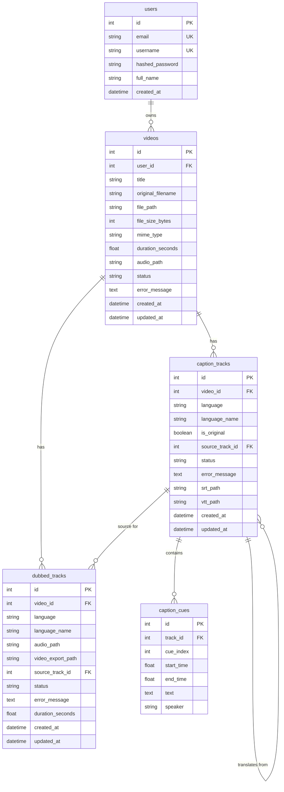
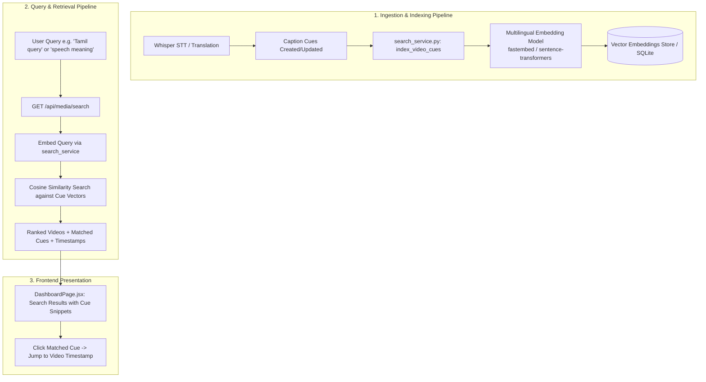

# Unified AI Media Platform - Comprehensive Project Code Map & Technical Audit

**Report Generated:** October 2026
**Project Workspace:** `unified-ai-media-platform`
**Target File:** `PROJECT_CODE_MAP.md`
**Status Audit Summary:**
- **Fully Implemented & Verified:** User Auth (JWT/bcrypt), Media Upload & PCM Audio Extraction (FFmpeg), English/Auto-Detect Transcription (Faster-Whisper CPU int8), Subtitle Translation (Deep-Translator), In-Browser Caption Editor & SRT/VTT Exports, Custom HTML5 Synchronized Player with CC Overlay.
- **Partially Implemented / Bugs Present:** Manual Non-English Whisper Transcription (locale code mismatch & VAD suppression), Timeline Dubbing Speech Output (routing bug feeding English cues into foreign TTS voice), Dashboard Search (SQL ILIKE title/filename only).
- **Unimplemented:** Multilingual Semantic Search & Vector/Transcript Indexing.

---

## 1. Project Folder Structure

```text
unified-ai-media-platform/
│
├── .env.example                          # Environment variable template
├── README.md                             # Project documentation and getting started guide
├── run_app.bat                           # Dual-server batch launcher (Backend + Frontend)
├── start_backend.bat                     # Dedicated launcher for FastAPI Uvicorn server
├── start_frontend.bat                    # Dedicated launcher for React Vite development server
├── sample_test_video.mp4                 # Bundled MP4 sample video for testing and validation
├── test_e2e_workflow.py                  # Full end-to-end regression and integration test script
├── PROJECT_CODE_MAP.md                   # System code map and technical audit report (This file)
│
├── backend/                              # FastAPI Backend Application Root
│   ├── media_platform.db                 # SQLite 3 Database (Stores users, media, captions, dubs)
│   ├── requirements.txt                  # Python runtime package dependencies
│   ├── test_backend.py                   # Automated backend API and unit test suite
│   │
│   ├── uploads/                          # Local Storage for Ingested and Processed Media
│   │   ├── audio/                        # Extracted 16kHz mono PCM WAV files for Whisper STT
│   │   ├── dubbed/                       # Generated dubbed WAV and MP3 audio files
│   │   │   └── temp/                     # Ephemeral per-cue TTS synthesis fragments
│   │   ├── exports/                      # Generated SRT, VTT subtitles and remuxed MP4 videos
│   │   └── videos/                       # Ingested original video files
│   │
│   └── app/                              # Core Application Package
│       ├── __init__.py                   # Package initialization
│       ├── auth.py                       # Passlib/bcrypt password hashing & JWT token handling
│       ├── config.py                     # App settings, directory paths, Whisper & language configs
│       ├── database.py                   # SQLAlchemy engine, session maker, DB lifecycle dependencies
│       ├── ffmpeg_utils.py               # FFmpeg locator, 16kHz WAV extraction, duration parser
│       ├── main.py                       # FastAPI application entry point, CORS, lifespan & health
│       ├── models.py                     # SQLAlchemy ORM models (User, Video, Tracks, Cues)
│       ├── schemas.py                    # Pydantic v2 validation models for requests and responses
│       ├── subtitle_utils.py             # SRT/VTT parsing and formatting utilities
│       ├── translation_service.py        # Multi-engine translation pipeline (MyMemory + Google)
│       ├── tts_service.py                # Edge TTS neural voice synthesis & timeline audio assembly
│       ├── whisper_service.py            # Faster-Whisper CPU model loader & transcription engine
│       │
│       └── routers/                      # Modular API Route Controllers
│           ├── __init__.py               # Routers package initialization
│           ├── auth_router.py            # Endpoints: /api/auth (register, login, me)
│           ├── caption_router.py         # Endpoints: /api/captions (transcribe, tracks, cues, export)
│           ├── dubbing_router.py         # Endpoints: /api/dubbing (generate, stream, export video)
│           ├── media_router.py           # Endpoints: /api/media (upload, list, detail, stream, delete)
│           └── translation_router.py     # Endpoints: /api/translation (languages, translate)
│
├── frontend/                             # React 18 + Vite Frontend Application Root
│   ├── index.html                        # HTML5 document entry point
│   ├── package.json                      # Node.js dependencies, build & dev scripts
│   ├── package-lock.json                 # Pinned npm dependency lockfile
│   ├── postcss.config.js                 # PostCSS configuration for Tailwind CSS
│   ├── tailwind.config.js                # Tailwind theme extensions, colors, and layout tokens
│   ├── vite.config.js                    # Vite configuration with `/api` and `/static` dev proxies
│   │
│   └── src/                              # Frontend React Source Code
│       ├── App.jsx                       # Root view switcher, navigation layout, modal manager
│       ├── index.css                     # Global styles, Tailwind directives, glassmorphic classes
│       ├── main.jsx                      # React 18 DOM mount point
│       │
│       ├── components/                   # Reusable UI & Media Components
│       │   ├── CaptionEditor.jsx         # In-browser subtitle cue editor with live table & seek
│       │   ├── LanguageSelector.jsx      # Modal for selecting multiple translation target languages
│       │   ├── MediaCard.jsx             # Library card with thumbnail, badges, duration & deletion
│       │   ├── Navbar.jsx                # Sticky glassmorphic header, navigation & user profile
│       │   ├── StatsCard.jsx             # Metric card with icons and blurred gradient accents
│       │   ├── UploadModal.jsx           # Drag-and-drop file upload dialog with progress tracking
│       │   └── VideoPlayer.jsx           # Custom video player with CC overlay & dubbed audio switcher
│       │
│       ├── context/                      # React Context Providers
│       │   └── AuthContext.jsx           # Authentication state, token persistence, login/logout hooks
│       │
│       ├── pages/                        # Top-level Page Views
│       │   ├── DashboardPage.jsx         # Media library, search bar, sort options, metric cards
│       │   ├── LoginPage.jsx             # Auth screen with Sign In / Register tabs & demo autofill
│       │   └── VideoDetailPage.jsx       # Studio workspace for STT, translation, dubbing & editing
│       │
│       └── services/                     # Network Communication Layer
│           └── api.js                    # Axios client, JWT interceptor, structured API modules
│
└── project-notes/                        # Developer Notes & Technical Documentation
    ├── CONTINUATION_NOTES.md             # Developer handover notes and execution steps
    ├── IMPLEMENTATION_STATUS.md          # Implementation state, bug tracking, and task lists
    ├── PROJECT_DEMO_AND_VIVA.md          # Academic demonstration and defense documentation
    └── PROJECT_REPORT_TECHNICAL_ANALYSIS.md # Complete architectural analysis and evaluation report
```

---

## 2. Backend Python Files and Responsibilities

| File Path | Core Responsibilities & Logic |
|---|---|
| `backend/app/__init__.py` | Package marker for the backend application module. |
| `backend/app/config.py` | Central configuration. Establishes filesystem directories (`uploads/videos`, `audio`, `dubbed`, `exports`), SQLite database path, JWT settings (HS256, 24-hour expiration), Faster-Whisper CPU parameters (`base` model, `int8` quantization), upload constraints (max 250MB, allowed audio/video extensions), and canonical registry of 20 supported languages. |
| `backend/app/database.py` | SQLAlchemy database engine connection (with `check_same_thread=False` for SQLite concurrent access), `SessionLocal` sessionmaker factory, `get_db()` dependency for FastAPI request lifecycles, and `init_db()` table creation. |
| `backend/app/models.py` | SQLAlchemy Declarative ORM models: `User`, `Video`, `CaptionTrack`, `CaptionCue`, and `DubbedTrack`. Configures primary keys, foreign keys, relationships, cascade deletes, and timestamp tracking. |
| `backend/app/schemas.py` | Pydantic v2 data models for input validation and output serialization across Auth, Videos, Caption Tracks, Caption Cues, Subtitle Translation, and Dubbed Audio tracks. |
| `backend/app/auth.py` | Authentication and cryptographic operations. Handles bcrypt password hashing (with safety truncation to 72 bytes), password verification, JWT access token generation, and the `get_current_user` OAuth2 Bearer dependency. |
| `backend/app/ffmpeg_utils.py` | Media utility wrappers around FFmpeg (detects system FFmpeg or bundles via `imageio-ffmpeg`). Functions: `get_ffmpeg_binary()`, `extract_audio_from_video()` (converts input media to 16kHz mono PCM 16-bit WAV for speech recognition), and `get_media_duration()` (parses video duration in seconds via stderr). |
| `backend/app/whisper_service.py` | Faster-Whisper speech-to-text inference engine. Applies PyAV 19+ compatibility patch, provides lazily initialized singleton `get_whisper_model()`, optimizes WAV loading via `load_audio_waveform()` into float32 NumPy arrays, and executes `transcribe_audio()` using Silero VAD filtering. |
| `backend/app/translation_service.py` | Text translation engine via `deep-translator`. Maps language codes to MyMemory locales (`LOCALE_MAP`), executes `translate_single_text()` using a fallback cascade (Primary: `MyMemoryTranslator` -> Secondary: `GoogleTranslator` -> Fallback: original text), and `translate_cues()` preserving exact cue timing and indices. |
| `backend/app/tts_service.py` | Neural text-to-speech synthesis and timeline dubbing synchronization. Maps 20+ languages to Microsoft Edge Neural voices (`EDGE_VOICES`), falls back to `gTTS`, converts cue audio to 16kHz PCM WAV with `atempo` duration matching, initializes a zero-filled NumPy silence buffer, places cue audio at exact timestamps, exports master WAV and compressed MP3, and multiplexes dubbed audio with original video (`export_dubbed_video()`). |
| `backend/app/subtitle_utils.py` | Subtitle file generation and parsing. Formats timestamps for SRT (`HH:MM:SS,mmm`) and WebVTT (`HH:MM:SS.mmm`), converts lists of cue objects/dictionaries to valid `.srt` and `.vtt` strings, and parses SRT files into cue lists. |
| `backend/app/main.py` | FastAPI application root. Configures application lifespan (startup DB initialization, FFmpeg binary check), sets up wide CORS middleware for development, mounts static directory `/static/uploads`, registers modular routers, and provides `/api/health`. |
| `backend/app/routers/__init__.py` | Package marker for route controllers. |
| `backend/app/routers/auth_router.py` | Auth route controller (`/api/auth`). Implements `/register` (duplicate check, bcrypt hash, token issue), `/login` (credential check, token issue), and `/me` (profile retrieval for active session). |
| `backend/app/routers/media_router.py` | Media route controller (`/api/media`). Implements `/upload` (streaming disk write up to 250MB, audio extraction, duration calculation), `/list` (filter by user and title/filename ILIKE search, sorting), `/{video_id}` (detailed track metadata), `/{video_id}/stream` (HTTP range streaming for video element), and `/{video_id}` deletion (DB cascade and disk cleanup). |
| `backend/app/routers/caption_router.py` | Caption route controller (`/api/captions`). Implements `/{video_id}/transcribe` (Whisper execution, track updating, cue creation, SRT/VTT file write), `/{video_id}/tracks` (track summaries), `/tracks/{track_id}` (detail with cues), `PUT /tracks/{track_id}` (cue editing, timing recalculation, SRT/VTT file regeneration), `/export/srt`, `/export/vtt`, and track deletion. |
| `backend/app/routers/translation_router.py` | Translation route controller (`/api/translation`). Implements `/languages` (retrieves supported language list) and `/{video_id}/translate` (translates source cues into one or more target languages, creates new tracks and cues, writes SRT/VTT files). |
| `backend/app/routers/dubbing_router.py` | Dubbed audio route controller (`/api/dubbing`). Implements `/{video_id}/generate` (resolves cue track, runs neural TTS and timeline assembly, registers DubbedTrack), `/{video_id}/tracks` (summaries), `/tracks/{track_id}/audio` (streaming MP3), `/download` (MP3 download), `/export-video` (FFmpeg remux into MP4), `/download-video` (MP4 download), and track deletion. |
| `backend/test_backend.py` | Regression test script for backend functionality using `fastapi.testclient.TestClient`. Tests health check, subtitle parsing/formatting roundtrips, user registration/login, protected routes, language endpoint, media list, and cue translation timing preservation. |
| `test_e2e_workflow.py` | Root-level end-to-end integration test. Validates the entire user workflow: auth -> video upload -> Whisper transcription -> duplicate prevention -> Tamil subtitle translation -> cue editing -> SRT/VTT export -> neural dubbing synthesis -> MP3 streaming -> MP4 video export -> media detail response. |

---

## 3. Frontend Source Files and Responsibilities

| File Path | Core Responsibilities & Logic |
|---|---|
| `frontend/src/main.jsx` | Client application entry point. Bootstraps React 18 using `ReactDOM.createRoot` inside `#root`, wrapped in `React.StrictMode`, and loads `index.css`. |
| `frontend/src/App.jsx` | Top-level application component and view orchestrator. Encloses the tree in `AuthProvider`. Manages state for `selectedVideoId` (toggling between `DashboardPage` and `VideoDetailPage`), controls `UploadModal` visibility, renders `Navbar` and the academic project footer. |
| `frontend/src/index.css` | Global styling layer. Injects Tailwind directives (`@tailwind base/components/utilities`), configures custom dark scrollbars, and defines reusable glassmorphic UI classes (`.glass-panel`, `.glass-card`, `.gradient-text`, `.glow-btn`). |
| `frontend/src/context/AuthContext.jsx` | React Context for state management of authentication. Manages `user` and `token` state with `localStorage` synchronization. Implements `login`, `register`, and `logout`. Listens for `'auth:logout'` window events to clear expired sessions. Exports `useAuth()` hook. |
| `frontend/src/services/api.js` | Central Axios HTTP client. Configured with baseURL `/api` and 300-second timeout. Request interceptor automatically attaches Bearer tokens. Response interceptor catches 401 Unauthorized errors and triggers automatic logout. Modular API namespaces: `authApi`, `mediaApi`, `captionApi`, `translationApi`, `dubbingApi`. |
| `frontend/src/pages/DashboardPage.jsx` | Primary home view after login. Fetches media list via `mediaApi.listVideos({ search, sort_by })`. Computes aggregate metrics (Total Media, Total Subtitle Tracks, Languages, Total Storage Used). Renders search bar, sort dropdown, and responsive grid of `MediaCard` components. Handles video deletion. |
| `frontend/src/pages/LoginPage.jsx` | Authentication page. Tabbed UI switching between Sign In and Create Account. Form fields for username, email, full name, and password with loading state and inline error alerts. Includes a "Fill Demo Credentials" shortcut for rapid viva/demo testing. |
| `frontend/src/pages/VideoDetailPage.jsx` | Interactive media studio page. Loads video details, caption tracks, and dubbed tracks. Hosts the 2-column layout: left column contains `VideoPlayer`, AI Workflow Hub (Step 1 Whisper STT & Step 2 Target Language Dub/Sub selection), and dubbed audio track manager; right column contains `CaptionEditor`. Orchestrates actions across transcription, translation, dubbing, video export, and track deletions. |
| `frontend/src/components/Navbar.jsx` | Sticky glassmorphic top navigation bar. Displays project branding, "Media Library" home button, "Upload Video" action button, active user badge, and logout trigger. |
| `frontend/src/components/MediaCard.jsx` | Video library item card. Displays video thumbnail placeholder with play button, duration badge, subtitle track count badge, dubbed track badge, title, original filename, file size, creation date, "Open Studio" button, and deletion button with browser confirmation. |
| `frontend/src/components/StatsCard.jsx` | Reusable analytics metric card. Displays title, main numeric/text value, subtitle, icon container, and glassmorphic background with colored blur glow. |
| `frontend/src/components/UploadModal.jsx` | Modal dialog for video file ingestion. Supports drag-and-drop or file browsing. Validates file extension against allowed list and enforces 250MB size limit. Tracks real-time upload progress percentage via Axios `onUploadProgress`. On completion, triggers callback opening the newly uploaded video in the studio. |
| `frontend/src/components/VideoPlayer.jsx` | Custom HTML5 video player component. Supports authenticated video range streaming, play/pause, seek slider, volume/mute, ±5s jump, fullscreen, and playback speeds (0.5x to 2.0x). Renders synchronized custom glassmorphic caption overlay synced to `currentTime`. Features a dual-audio engine: when a dubbed track is active, mutes the `<video>` element, plays the dubbed MP3 via an `<audio>` element, and continuously monitors and corrects audio-video drift (>0.25s). |
| `frontend/src/components/CaptionEditor.jsx` | Live in-browser subtitle editor. Displays editable list of cues with start time, end time, and text inputs. Includes search filter across cue texts. Supports adding cues at current video playback position, deleting cues, seeking the player to specific cue timestamps, saving edits back to SQLite via `PUT`, and exporting `.srt` or `.vtt` files directly. |
| `frontend/src/components/LanguageSelector.jsx` | Multi-language translation modal. Fetches supported languages from backend (`/api/translation/languages`) with hardcoded fallback. Allows multi-selection of target languages with checkboxes. Submits batch translation request for the active caption track. |

---

## 4. Implemented Features, Code Files, and Verification Status

The table below distinguishes **Implemented & Verified**, **Partially Implemented**, and **Unimplemented** features based on actual code inspection and test execution:

| Feature | Implementation Status | Responsible Code Files | Audit Notes & Verification Evidence |
|---|---|---|---|
| **User Authentication & Authorization** | **IMPLEMENTED & VERIFIED** | `backend/app/auth.py`<br>`backend/app/routers/auth_router.py`<br>`backend/app/models.py`<br>`frontend/src/context/AuthContext.jsx`<br>`frontend/src/pages/LoginPage.jsx` | Password hashing with bcrypt, JWT token generation, route protection with `get_current_user`, auto-logout on 401. Fully verified in `backend/test_backend.py` (steps 3–5) and `test_e2e_workflow.py` (step 1). |
| **Media Upload & Audio Extraction** | **IMPLEMENTED & VERIFIED** | `backend/app/ffmpeg_utils.py`<br>`backend/app/routers/media_router.py`<br>`frontend/src/components/UploadModal.jsx` | Multipart upload streams to disk, enforces 250MB limit, extracts 16kHz mono PCM WAV via bundled FFmpeg, parses duration. Fully verified in `test_e2e_workflow.py` (step 2). |
| **Speech-to-Text (Auto-Detect Spoken Language)** | **IMPLEMENTED & VERIFIED** | `backend/app/whisper_service.py`<br>`backend/app/routers/caption_router.py`<br>`frontend/src/pages/VideoDetailPage.jsx` | Faster-Whisper `base` CPU int8 transcription runs when `source_language` is None or 'auto'. Generates timestamped cues and saves SRT/VTT. Verified in `test_e2e_workflow.py` (steps 3–4). |
| **Speech-to-Text (Manual Non-English Selection)** | **PARTIALLY IMPLEMENTED (Known Bug)** | `backend/app/whisper_service.py`<br>`backend/app/routers/caption_router.py`<br>`frontend/src/pages/VideoDetailPage.jsx` | UI dropdown offers non-English languages (Tamil, Hindi, etc.), but Whisper raises `ValueError` if regional codes like `zh-CN` are passed. Silero VAD settings (`min_silence_duration_ms=500`) trigger false positive silence on accented/non-English audio, returning HTTP 400. Windows console output can crash on Unicode charmap encoding. |
| **Multi-Language Subtitle Translation** | **IMPLEMENTED & VERIFIED** | `backend/app/translation_service.py`<br>`backend/app/routers/translation_router.py`<br>`frontend/src/components/LanguageSelector.jsx` | Multi-engine translation (`MyMemoryTranslator` + `GoogleTranslator` fallback) translates cues while maintaining exact `start_time` and `end_time`. Verified in `backend/test_backend.py` (step 8) and `test_e2e_workflow.py` (step 5). |
| **In-Browser Caption Editor & Subtitle Export** | **IMPLEMENTED & VERIFIED** | `backend/app/subtitle_utils.py`<br>`backend/app/routers/caption_router.py`<br>`frontend/src/components/CaptionEditor.jsx` | Live editing of cue start, end, and text; adding/deleting cues; persistence to SQLite; live dynamic generation and download of `.srt` and `.vtt`. Verified in `test_e2e_workflow.py` (step 6). |
| **Synchronized Video Player with Custom CC** | **IMPLEMENTED & VERIFIED** | `frontend/src/components/VideoPlayer.jsx`<br>`backend/app/routers/media_router.py` | Custom HTML5 video playback, range requests for smooth seeking, custom glassmorphic caption overlay dynamically displaying cues based on `currentTime`. |
| **Timeline-Aligned Audio Dubbing Synthesis** | **PARTIALLY IMPLEMENTED (Known Routing Bug)** | `backend/app/tts_service.py`<br>`backend/app/routers/dubbing_router.py`<br>`frontend/src/pages/VideoDetailPage.jsx` | Audio synthesis pipeline (Edge TTS + gTTS fallback + WAV timeline buffer + silence padding + `atempo` sync) works physically. HOWEVER, `VideoDetailPage.jsx` sends the English original track ID as `source_track_id`, and `dubbing_router.py` feeds those English cues into the target language neural voice, causing it to speak English words in a foreign accent instead of the translated language. |
| **Export Dubbed MP4 Video** | **IMPLEMENTED & VERIFIED** | `backend/app/tts_service.py`<br>`backend/app/routers/dubbing_router.py`<br>`frontend/src/pages/VideoDetailPage.jsx` | Uses FFmpeg (`-map 0:v:0 -map 1:a:0 -c:v copy -c:a aac -shortest`) to multiplex the dubbed audio track with the video stream into a standalone MP4 file. Verified in `test_e2e_workflow.py` (steps 10–11). |
| **Dashboard Video Search** | **PARTIALLY IMPLEMENTED (Basic SQL Only)** | `backend/app/routers/media_router.py`<br>`frontend/src/pages/DashboardPage.jsx` | SQL `ILIKE` substring search filtering only `Video.title` and `Video.original_filename`. Does not search transcripts, cues, subtitles, or foreign languages. |
| **Multilingual Semantic Video Search** | **NOT IMPLEMENTED** | None | No vector embedding models, embedding storage, or semantic search endpoints currently exist in the codebase. |

---

## 5. Database Models and API Endpoints

### 5.1 Database Models (SQLAlchemy ORM)

All models inherit from `declarative_base()` in `backend/app/database.py` and are stored in `backend/media_platform.db` (SQLite):



#### Detailed Model Attribute Specifications

1. **`User` (`users` table):**
   - `id`: `Integer`, Primary Key, indexed.
   - `email`: `String(255)`, unique, indexed, non-nullable.
   - `username`: `String(100)`, unique, indexed, non-nullable.
   - `hashed_password`: `String(255)`, non-nullable.
   - `full_name`: `String(150)`, nullable.
   - `created_at`: `DateTime`, default UTC now.
   - Relationship: `videos` -> `Video` (cascade delete-orphan).

2. **`Video` (`videos` table):**
   - `id`: `Integer`, Primary Key, indexed.
   - `user_id`: `Integer`, Foreign Key (`users.id`), indexed, non-nullable.
   - `title`: `String(255)`, non-nullable.
   - `original_filename`: `String(255)`, non-nullable.
   - `file_path`: `String(500)`, non-nullable.
   - `file_size_bytes`: `Integer`, default 0.
   - `mime_type`: `String(100)`, default `"video/mp4"`.
   - `duration_seconds`: `Float`, default 0.0.
   - `audio_path`: `String(500)`, nullable (path to extracted 16kHz WAV).
   - `status`: `String(50)`, default `"READY"` (`UPLOADED`, `EXTRACTING_AUDIO`, `TRANSCRIBING`, `READY`, `ERROR`).
   - `error_message`: `Text`, nullable.
   - `created_at` / `updated_at`: `DateTime`.
   - Relationships: `user` -> `User`, `caption_tracks` -> `CaptionTrack`, `dubbed_tracks` -> `DubbedTrack`.

3. **`CaptionTrack` (`caption_tracks` table):**
   - `id`: `Integer`, Primary Key, indexed.
   - `video_id`: `Integer`, Foreign Key (`videos.id`), indexed, non-nullable.
   - `language`: `String(10)`, non-nullable (e.g. `'en'`, `'ta'`, `'hi'`).
   - `language_name`: `String(50)`, non-nullable (e.g. `'English'`, `'Tamil'`).
   - `is_original`: `Boolean`, default `False` (True if generated from Whisper STT).
   - `source_track_id`: `Integer`, Foreign Key (`caption_tracks.id`), nullable.
   - `status`: `String(50)`, default `"READY"`.
   - `error_message`: `Text`, nullable.
   - `srt_path`: `String(500)`, nullable.
   - `vtt_path`: `String(500)`, nullable.
   - `created_at` / `updated_at`: `DateTime`.
   - Relationships: `video` -> `Video`, `cues` -> `CaptionCue` (ordered by `start_time`).

4. **`CaptionCue` (`caption_cues` table):**
   - `id`: `Integer`, Primary Key, indexed.
   - `track_id`: `Integer`, Foreign Key (`caption_tracks.id`), indexed, non-nullable.
   - `cue_index`: `Integer`, non-nullable (1-based sequence index).
   - `start_time`: `Float`, non-nullable (timestamp in seconds).
   - `end_time`: `Float`, non-nullable (timestamp in seconds).
   - `text`: `Text`, non-nullable (cue content string).
   - `speaker`: `String(50)`, nullable.
   - Relationship: `track` -> `CaptionTrack`.

5. **`DubbedTrack` (`dubbed_tracks` table):**
   - `id`: `Integer`, Primary Key, indexed.
   - `video_id`: `Integer`, Foreign Key (`videos.id`), indexed, non-nullable.
   - `language`: `String(10)`, non-nullable (e.g. `'ta'`, `'es'`).
   - `language_name`: `String(50)`, non-nullable.
   - `audio_path`: `String(500)`, non-nullable (path to final synchronized MP3).
   - `video_export_path`: `String(500)`, nullable (path to exported MP4).
   - `source_track_id`: `Integer`, Foreign Key (`caption_tracks.id`), nullable.
   - `status`: `String(50)`, default `"READY"`.
   - `error_message`: `Text`, nullable.
   - `duration_seconds`: `Float`, default 0.0.
   - `created_at` / `updated_at`: `DateTime`.
   - Relationship: `video` -> `Video`.

---

### 5.2 API Endpoints

| Category | HTTP Method & Path | Auth Required | Request Body / Parameters | Response Schema | Description |
|---|---|---|---|---|---|
| **Health** | `GET /api/health` | No | None | `{"status", "app", "version", "ffmpeg"}` | Server health and FFmpeg binary check |
| **Auth** | `POST /api/auth/register` | No | `UserRegister` (email, username, password, full_name) | `TokenResponse` (201 Created) | Creates new user with bcrypt hash; returns JWT |
| **Auth** | `POST /api/auth/login` | No | `UserLogin` (username_or_email, password) | `TokenResponse` (200 OK) | Authenticates user; returns JWT |
| **Auth** | `GET /api/auth/me` | Yes (Bearer) | None | `UserResponse` (200 OK) | Returns profile of current authenticated user |
| **Media** | `POST /api/media/upload` | Yes (Bearer) | `file`: `UploadFile` (multipart/form-data) | `VideoResponse` (201 Created) | Uploads video, extracts audio, records metadata |
| **Media** | `GET /api/media/list` | Yes (Bearer) | Query: `search` (str), `sort_by` (`newest`, `oldest`, `title`) | `List[VideoResponse]` (200 OK) | Lists current user's videos with basic ILIKE search |
| **Media** | `GET /api/media/{video_id}` | Yes (Bearer) | Path: `video_id` (int) | `VideoDetailResponse` (200 OK) | Full video details including tracks & dubbed tracks |
| **Media** | `GET /api/media/{video_id}/stream` | Optional token | Path: `video_id`, Query: `token` (JWT) | `FileResponse` (200 / 206) | Streams video file with HTTP range headers |
| **Media** | `DELETE /api/media/{video_id}` | Yes (Bearer) | Path: `video_id` (int) | `{"message", "id"}` (200 OK) | Deletes video, DB records, audio, SRT, VTT, MP4 files |
| **Captions** | `POST /api/captions/{video_id}/transcribe` | Yes (Bearer) | Path: `video_id`, Body: `TranscribeRequest` | `CaptionTrackResponse` (200 OK) | Runs Faster-Whisper, stores cues, creates SRT/VTT |
| **Captions** | `GET /api/captions/{video_id}/tracks` | Yes (Bearer) | Path: `video_id` (int) | `List[CaptionTrackSummaryResponse]` | Lists all caption tracks for a video |
| **Captions** | `GET /api/captions/tracks/{track_id}` | Yes (Bearer) | Path: `track_id` (int) | `CaptionTrackResponse` (200 OK) | Returns track details and full cue list |
| **Captions** | `PUT /api/captions/tracks/{track_id}` | Yes (Bearer) | Path: `track_id`, Body: `CaptionTrackUpdate` | `CaptionTrackResponse` (200 OK) | Replaces cues, re-sorts times, regenerates SRT/VTT |
| **Captions** | `GET /api/captions/tracks/{track_id}/export/srt` | Public/Token | Path: `track_id` (int) | `FileResponse` / Text (`.srt`) | Serves formatted SRT subtitle file |
| **Captions** | `GET /api/captions/tracks/{track_id}/export/vtt` | Public/Token | Path: `track_id`, Query: `download` (bool) | `Response` (`text/vtt`) | Serves formatted WebVTT subtitle file |
| **Captions** | `DELETE /api/captions/tracks/{track_id}` | Yes (Bearer) | Path: `track_id` (int) | `{"message", "id"}` (200 OK) | Deletes caption track and disk files |
| **Translation** | `GET /api/translation/languages` | No | None | `List[SupportedLanguage]` (200 OK) | Returns 20 supported target languages |
| **Translation** | `POST /api/translation/{video_id}/translate` | Yes (Bearer) | Path: `video_id`, Body: `TranslateRequest` | `List[CaptionTrackResponse]` (200 OK) | Translates source track cues into target languages |
| **Dubbing** | `POST /api/dubbing/{video_id}/generate` | Yes (Bearer) | Path: `video_id`, Body: `GenerateDubRequest` | `DubbedTrackResponse` (200 OK) | Generates timeline-aligned neural dubbed audio |
| **Dubbing** | `GET /api/dubbing/{video_id}/tracks` | Yes (Bearer) | Path: `video_id` (int) | `List[DubbedTrackSummaryResponse]` | Lists all dubbed tracks for a video |
| **Dubbing** | `GET /api/dubbing/tracks/{track_id}/audio` | Optional token | Path: `track_id`, Query: `token` | `FileResponse` (`audio/mpeg`) | Streams dubbed MP3 file with range support |
| **Dubbing** | `GET /api/dubbing/tracks/{track_id}/download` | Public | Path: `track_id` (int) | `FileResponse` (`audio/mpeg`) | Direct download of dubbed MP3 audio file |
| **Dubbing** | `POST /api/dubbing/tracks/{track_id}/export-video` | Yes (Bearer) | Path: `track_id` (int) | `{"message", "track_id", "filename", ...}` | Remuxes video with dubbed audio via FFmpeg |
| **Dubbing** | `GET /api/dubbing/tracks/{track_id}/download-video` | Public | Path: `track_id` (int) | `FileResponse` (`video/mp4`) | Direct download of exported dubbed MP4 video |
| **Dubbing** | `DELETE /api/dubbing/tracks/{track_id}` | Yes (Bearer) | Path: `track_id` (int) | `{"message", "id"}` (200 OK) | Deletes dubbed track, audio file, and exported video |

---

## 6. Current Translation and Dubbing Implementation

### 6.1 Subtitle Translation Pipeline

```
[Source CaptionTrack Cues] (Original English or Spoken Speech)
                 │
                 ▼
[translate_cues() in translation_service.py]
  ├── For each cue:
  │     ├── translate_single_text(cue.text, source_lang, target_lang)
  │     │     ├── Strategy 1: MyMemoryTranslator(source_locale, target_locale)
  │     │     ├── Strategy 2: GoogleTranslator fallback (if MyMemory fails)
  │     │     └── Strategy 3: Original text fallback (if both fail)
  │     └── Preserve exact: cue_index, start_time, end_time
  │
  ▼
[Database & Disk Persistence in translation_router.py]
  ├── CaptionTrack (is_original=False, language=target_lang)
  ├── CaptionCue records with translated text
  ├── generate_srt() -> backend/uploads/exports/track_{id}_{lang}.srt
  └── generate_vtt() -> backend/uploads/exports/track_{id}_{lang}.vtt
```

- **Supported Languages:** 20 languages defined in `config.py:SUPPORTED_LANGUAGES`: Spanish (`es`), French (`fr`), German (`de`), Hindi (`hi`), Tamil (`ta`), Telugu (`te`), Malayalam (`ml`), Kannada (`kn`), Marathi (`mr`), Bengali (`bn`), Chinese Simplified (`zh-CN`), Japanese (`ja`), Korean (`ko`), Arabic (`ar`), Russian (`ru`), Portuguese (`pt`), Italian (`it`), Dutch (`nl`), Urdu (`ur`), English (`en`).
- **Locale Mapping:** `LOCALE_MAP` converts 2-letter codes into locale strings required by MyMemory (e.g. `ta` -> `ta-IN`, `hi` -> `hi-IN`, `zh` -> `zh-CN`).
- **Timing Preservation:** The translation process modifies only the text attribute of each cue, leaving `start_time` and `end_time` floats unaltered.

---

### 6.2 Audio Dubbing Pipeline & The Target-Language Bug

```
[VideoDetailPage.jsx: handleGenerateDub()]
  │
  │ Sends POST /api/dubbing/{video_id}/generate
  │ Payload: { target_language: "ta", source_track_id: origTrack.id }
  │                                                      ▲
  │                     *** BUG OCCURS HERE ***          │
  │              (Passes English Original Track ID) ─────┘
  │
  ▼
[dubbing_router.py: generate_dub()]
  │
  │ 1. Checks if req.source_track_id is provided:
  │    caption_track = db.query(CaptionTrack).filter(id == req.source_track_id).first()
  │    (Because source_track_id is passed, it selects the English track directly!)
  │    (It DOES NOT check if caption_track.language matches target_lang!)
  │    (It bypasses lines 62-108 which would have translated English -> Tamil!)
  │
  ▼
[tts_service.py: generate_dubbed_audio()]
  │
  │ Cues passed: English cues ("Welcome to the Unified AI Platform", etc.)
  │ Target Voice: "ta-IN-PallaviNeural" (Tamil Neural Voice)
  │
  ▼
[Neural TTS Synthesis]
  │
  │ Edge TTS voice "ta-IN-PallaviNeural" is fed English text: "Welcome to..."
  │ Result: Speech synthesizer reads English words with a Tamil accent,
  │         INSTEAD OF reading translated Tamil words!
  │
  ▼
[Timeline Buffer Assembly]
  ├── 16kHz mono silence buffer: np.zeros(total_samples, dtype=np.int16)
  ├── Each cue synthesized -> converted to PCM WAV -> placed at start_time offset
  ├── atempo tempo filter applied if audio exceeds cue slot by >8%
  ├── Saved as dubbed_{video_id}_{lang}.wav & dubbed_{video_id}_{lang}.mp3
  └── export_dubbed_video() remuxes into MP4 via FFmpeg
```

#### Detailed Explanation of the Bug
1. In `frontend/src/pages/VideoDetailPage.jsx` (lines 155–160):
   ```javascript
   const origTrack = tracks.find((t) => t.is_original) || tracks[0];
   const res = await dubbingApi.generateDub(
     videoId,
     targetLanguage,
     origTrack ? origTrack.id : null  // <--- Passes original track ID
   );
   ```
2. In `backend/app/routers/dubbing_router.py` (lines 49–60):
   ```python
   caption_track = None
   if req.source_track_id:
       caption_track = db.query(CaptionTrack).filter(
           CaptionTrack.id == req.source_track_id,
           CaptionTrack.video_id == video_id
       ).first()
   ```
   When `source_track_id` is supplied, `caption_track` is set immediately to the English original track. The auto-translation logic in lines 62–108 is guarded by `if not caption_track:`, so it is completely bypassed.
3. As a result, English cue strings are sent to `generate_dubbed_audio()` with `language_code="ta"`. The Edge TTS synthesizer uses the Tamil voice `ta-IN-PallaviNeural` to pronounce English sentences rather than synthesized Tamil sentences.

---

## 7. Existing Search Functionality and Supported Capabilities

### 7.1 Current Search Code Analysis

1. **Backend Implementation (`backend/app/routers/media_router.py`, lines 112–116):**
   ```python
   if search:
       search_filter = f"%{search.strip()}%"
       query = query.filter(
           (Video.title.ilike(search_filter)) | (Video.original_filename.ilike(search_filter))
       )
   ```
2. **Frontend Trigger (`frontend/src/pages/DashboardPage.jsx`, lines 131–140):**
   ```jsx
   <input
     type="text"
     placeholder="Search by title..."
     value={search}
     onChange={(e) => setSearch(e.target.value)}
     className="..."
   />
   ```
   This triggers an automated refetch via `useEffect` with debounce on each keystroke: `mediaApi.listVideos({ search, sort_by: sortBy })`.

### 7.2 Capabilities vs Limitations

| Capability | Current Status | Details |
|---|---|---|
| Search by Video Title | **Supported** | Case-insensitive SQL `ILIKE '%...%'` on `Video.title` |
| Search by Original Filename | **Supported** | Case-insensitive SQL `ILIKE '%...%'` on `Video.original_filename` |
| Search Video Transcripts / Speech Content | **NOT Supported** | Caption cues (`CaptionCue.text`) are completely unqueried |
| Search Translated Subtitles | **NOT Supported** | Translated subtitle tracks are completely excluded |
| Multilingual Script Search (e.g. Tamil queries) | **NOT Supported** | Searching Tamil keywords (e.g. "வணக்கம்", "செயற்கை நுண்ணறிவு") returns 0 results for English title videos |
| Semantic / Conceptual Similarity Search | **NOT Supported** | Substring exact matching only. No synonym matching, semantic vector distance, or meaning matching |
| Direct Timestamp / Cue Jump from Search | **NOT Supported** | Search results only return whole video objects, with no match timestamps |

---

## 8. Files and Integration Points for Multilingual Semantic Search

To implement **Multilingual Semantic Video Search** based on video content, transcripts, and meaning (supporting queries in English, Tamil, and other languages), the following files and integration points must be developed or modified:



### 8.1 Required Backend Files and Changes

1. **`backend/requirements.txt` (Dependencies):**
   - Add a lightweight, CPU-efficient multilingual embedding package:
     - Recommended: `fastembed>=0.2.0` (runs ONNX-quantized multilingual models on CPU without PyTorch overhead) OR `sentence-transformers>=2.5.0` using `paraphrase-multilingual-MiniLM-L12-v2` (supports 50+ languages including Tamil, Hindi, English).
2. **`backend/app/search_service.py` (New Service):**
   - **Model Loader:** Lazily loads and caches the multilingual embedding model on CPU.
   - **`index_video_cues(video_id: int, db: Session)`:** Extracts all cue texts for a video (original and translated), groups them into coherent contextual chunks, generates embeddings, and persists them.
   - **`search_multilingual(query: str, user_id: int, db: Session, limit: int = 10)`:** Embeds the incoming query (in English, Tamil, Hindi, etc.), computes cosine similarity against stored cue vectors for the user's videos, and returns ranked matches.
3. **`backend/app/models.py` (Database Model Extensions):**
   - Add a search index model or column:
     ```python
     class CueEmbedding(Base):
         __tablename__ = "cue_embeddings"
         id = Column(Integer, primary_key=True, index=True)
         video_id = Column(Integer, ForeignKey("videos.id"), nullable=False, index=True)
         track_id = Column(Integer, ForeignKey("caption_tracks.id"), nullable=False)
         cue_id = Column(Integer, ForeignKey("caption_cues.id"), nullable=False)
         language = Column(String(10), nullable=False)
         text = Column(Text, nullable=False)
         start_time = Column(Float, nullable=False)
         end_time = Column(Float, nullable=False)
         vector = Column(Text, nullable=False)  # JSON-serialized float array or BLOB
     ```
4. **`backend/app/schemas.py` (New Schemas):**
   - `SemanticSearchMatch`: `cue_id`, `cue_text`, `start_time`, `end_time`, `language`, `score`.
   - `SemanticSearchResult`: `video_id`, `video_title`, `duration_seconds`, `matches: List[SemanticSearchMatch]`.
5. **`backend/app/routers/media_router.py` (New Endpoint / Enhancement):**
   - Implement `GET /api/media/search?query=...&mode=semantic`:
     - Calls `search_multilingual(query, current_user.id, db)`.
     - Returns videos ranked by semantic relevance along with the matching cues and timestamps.
6. **Automatic Indexing Integration Points:**
   - In `backend/app/routers/caption_router.py`: In `transcribe_video()`, call `search_service.index_video_cues()` after cues are saved.
   - In `backend/app/routers/translation_router.py`: In `translate_video_captions()`, call `search_service.index_video_cues()` after translated cues are saved.
   - In `backend/app/routers/caption_router.py`: In `update_track_cues()`, re-index modified cues.

---

### 8.2 Required Frontend Files and Changes

1. **`frontend/src/services/api.js`:**
   - Add semantic search method to `mediaApi`:
     ```javascript
     searchSemantic: (query) => api.get('/media/search', { params: { query } }),
     ```
2. **`frontend/src/pages/DashboardPage.jsx`:**
   - Add a search mode toggle (Title Search vs Multilingual Semantic Search).
   - Display matched cue snippets, match confidence, and timestamp pills beneath matching video cards.
   - Provide a direct seek link: clicking a matched cue opens `VideoDetailPage` and immediately seeks to `matched_cue.start_time`.
3. **`frontend/src/pages/VideoDetailPage.jsx`:**
   - Support receiving an initial timestamp from navigation (e.g. `initialSeekTime`) to automatically play from the semantically matched cue moment.

---

## 9. Comprehensive Architectural Summary

```text
=============================================================================================
UNIFIED AI MEDIA PLATFORM - ARCHITECTURAL DATA FLOW & VERIFICATION MATRIX
=============================================================================================

1. INGESTION & SPEECH RECOGNITION
   Client Upload -> /api/media/upload -> Save Video -> FFmpeg 16kHz PCM WAV Extraction
        │                                                              │
        ▼                                                              ▼
   SQLite (Video Record: READY)                             SQLite (audio_path stored)
        │
        ├──> POST /api/captions/{id}/transcribe
        │         │
        │         ├──> Faster-Whisper (CPU int8)
        │         │         ├──> Auto Language Detect: [VERIFIED WORKING]
        │         │         └──> Manual Language Select: [PARTIAL - Tokenizer & VAD Bugs]
        │         │
        │         └──> Generates CaptionTrack (is_original=True) + CaptionCue records
        │              Exports .srt and .vtt files to uploads/exports/
        │
2. SUBTITLE TRANSLATION & EDITING
   CaptionTrack Cues -> POST /api/translation/{id}/translate
        │
        ├──> deep-translator (MyMemoryTranslator with GoogleTranslator Fallback)
        │         ├──> 20 Supported Target Languages (ta, hi, es, fr, de, etc.)
        │         └──> Preserves cue_index, start_time, end_time: [VERIFIED WORKING]
        │
        └──> Saves Translated CaptionTrack + Cues + .srt/.vtt exports
        │
   PUT /api/captions/tracks/{id} -> Live Cue Editing & Re-synchronization: [VERIFIED WORKING]
        │
3. TIMELINE-ALIGNED AUDIO DUBBING
   POST /api/dubbing/{id}/generate
        │
        ├──> Route Handler Logic: [BUG IDENTIFIED]
        │         └──> Passes English cues to foreign voice if source_track_id passed
        │
        ├──> Neural TTS Synthesis (Edge-TTS + gTTS fallback): [VERIFIED WORKING]
        ├──> Digital Silence Insertion & atempo Timing Fit: [VERIFIED WORKING]
        ├──> Master WAV & MP3 Encoding: [VERIFIED WORKING]
        └──> FFmpeg Video Remuxing (MP4 Export): [VERIFIED WORKING]
        │
4. PLAYBACK & MEDIA DISCOVERY
   VideoPlayer.jsx -> Range Video Streaming + Synchronized CC Glassmorphic Overlay
        │         -> Dual-audio synchronizer for dubbed MP3 with drift correction
        │
   Media Search -> /api/media/list?search=...
        ├──> Current SQL ILIKE on Title/Filename: [VERIFIED BASIC]
        └──> Multilingual Semantic Search & Vector Indexing: [NOT IMPLEMENTED]
=============================================================================================
```

*Report compiled strictly without file modifications, and without exposing sensitive credentials or keys.*
